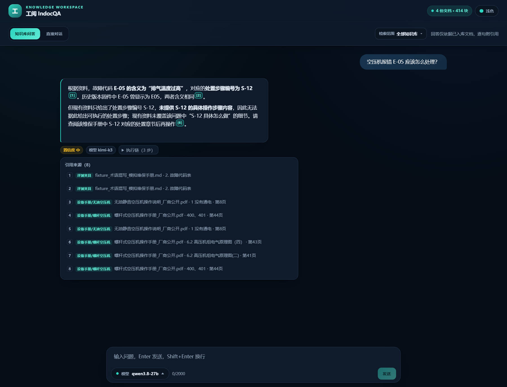
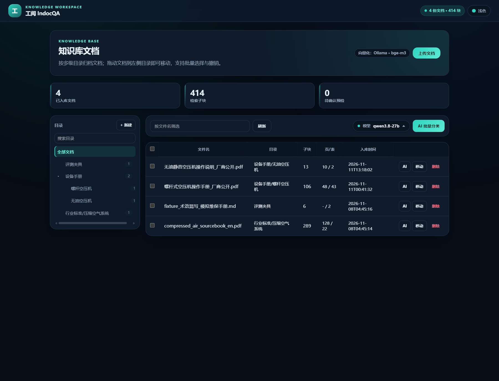
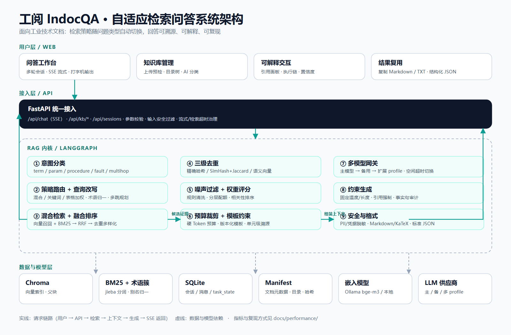

# 工阅 IndocQA · 自适应检索问答

面向**工业技术文档**的检索增强问答系统：把设备手册、维修规程、故障代码表交给它，用自然语言提问，得到**带出处、带推理链、带置信度**的回答。

它不是“一套参数打天下”的朴素 RAG——系统会先判断问题类型，再决定检索策略；跨文档问题自动多跳，资料不足时明确拒答。每一项设计都有可复现的评测数字支撑。

<p>
  
  
  
  
  
  
  
</p>



## 目录

- [项目简介](#项目简介)
- [核心能力](#核心能力)
- [系统架构](#系统架构)
- [核心技术点](#核心技术点)
- [性能与评测](#性能与评测)
- [快速开始](#快速开始)
- [使用示例](#使用示例)
- [项目结构](#项目结构)
- [文档导航](#文档导航)
- [测试与复现](#测试与复现)
- [常见问题](#常见问题)
- [Roadmap](#roadmap)
- [许可证](#许可证)

## 项目简介

工业文档问答的难点不是“把文档塞进向量库”，而是**同一个系统要同时应对五种完全不同的问法**：

| 问法 | 典型问题 | 需要的检索行为 |
| --- | --- | --- |
| 术语解释 | MTBF 是什么意思？ | 语义匹配 + 缩写/别名归一 |
| 参数查询 | LUB 多久更换一次？ | 精确命中表格行与耗材型号 |
| 操作步骤 | 排气温度过高怎么处理？ | 章节定位 + 步骤顺序完整 |
| 故障诊断 | 报错 E-05 是什么含义？ | 故障码精确匹配 → 关联处置 |
| 跨文档关联 | MTBF 和储气罐的作用分别是什么？ | 多跳检索，逐跳溯源 |

工阅 IndocQA 的做法是：**意图分类 → 策略路由 → 混合检索 → 多跳补查 → 上下文组装 → 约束生成**。所有环节都保留执行痕迹，回答中的每个 `[n]` 都能回溯到文档、章节、页码或表格行。

## 核心能力

- **自适应检索路由**：术语/参数/步骤/故障/多跳五类问法分别匹配混合检索、关键词检索、表格加权与多跳补查，而不是固定参数。
- **混合检索与术语归一**：向量召回 + BM25 精确匹配，RRF 融合排序；`MTBF`/`M.T.B.F.`/`平均无故障时间`、`E-05`/`E05` 自动归一。
- **多跳推理链**：跨章节/跨文档问题分步检索，执行链面板展示分类、每跳查询、命中数与收敛判断。
- **上下文组装**：精确/近重复/语义三级去重、噪声过滤、权重排序、硬 Token 预算、版本化约束模板与单元级溯源。
- **生成层加固**：固定温度与最大长度、Markdown 感知引用审计、标准 JSON 输出、输入/输出安全过滤与 PII 脱敏。
- **可解释回答**：逐句引用、置信度（检索分布 + 引用覆盖 + 模型自评）、知识边界标注与拒答策略。
- **会话多模态附件**：图片/文档/音频/视频分片上传、进度与重试、文档文本解析、图片/音视频预览、会话级上下文与消息流渲染，不写入全局知识库。
- **工程化文档管理**：上传预检、重复检测、多级目录、拖拽移动与撤销、AI 辅助分类、目录树横向滚动。
- **多模型网关**：主/备/任意多套 profile，流式空闲超时自动切换，前端可选择实际使用模型。
- **可复现评测**：40 题标注集、固定参数基线、上下文专项评测、全链路性能基准，一条命令生成报告与图表。

| 文档管理 | 复制与导出 |
| --- | --- |
|  |  |

## 系统架构



一次问答的完整链路：

```text
用户提问
  → FastAPI /api/chat（参数校验、输入安全过滤）
  → LangGraph 意图分类（term / param / procedure / fault / multihop）
  → 策略路由 + 查询改写（术语归一、多跳规划）
  → 混合检索（Chroma 向量 + BM25 → RRF）
  → 上下文组装（去重 → 噪声过滤 → 权重/预算 → 模板 → 溯源）
  → LLMGateway（主模型 → 备用 → 扩展 profile）
  → 引用审计 + 安全过滤 + Markdown/JSON
  → SSE 流式输出（trace / sources / context / token / done）
```

> 架构图源文件：[`docs/assets/architecture.svg`](docs/assets/architecture.svg)

## 核心技术点

### 1. 意图驱动的检索路由

`server/app/retrieval/router.py` 为五类意图定义不同策略：

| 意图 | 策略 | 关键参数 |
| --- | --- | --- |
| 术语 | 混合检索 | 术语扩展、top6 |
| 参数 | 混合 + 表格加权 | 表格分数 ×1.12 |
| 步骤 | 混合检索 | 不扩展、章节完整 |
| 故障 | 关键词检索 | 故障码精确匹配、top8 |
| 多跳 | 混合 + 多跳 | 最多 2 跳，实体补查 |

固定参数基线（`INDOCQA_RETRIEVAL_MODE=fixed`）走同一张图、同一套代码，仅关闭路由差异，保证对比实验公平。

### 2. 混合检索与 RRF 融合

`server/app/retrieval/searcher.py`：

- 语义路：`bge-m3` 向量召回，跨语种问题有单路高分补偿；
- 词法路：`jieba` + BM25，故障码/型号精确命中额外加权；
- 融合：RRF（`K=60`）只依赖排名，不依赖分数尺度；
- 去重多样化：避免同一文档的相邻块占满结果。

### 3. 多跳检索

跨文档问题在首跳后检查实体覆盖，未覆盖则生成子查询补查，合并结果并重新排序。执行链会记录每一跳的查询与命中数，便于定位“哪一跳丢了”。

### 4. 上下文组装

`server/app/context/` 将检索结果、历史、任务状态、用户画像融合为受控上下文：

- **三级去重**：精确哈希 → SimHash + 3-gram Jaccard → 语义相似度；
- **噪声过滤**：低相关块、重复导航文本、空壳段落；
- **动态预算**：按模型上下文窗口与输出预留计算硬预算，分层配额；
- **约束模板**：版本化模板（`kb-answer@1`）规定引用与拒答格式；
- **全链路溯源**：每个上下文单元携带 `unitId / docId / chunkId / contentHash`。

### 5. 生成层加固

`server/app/generation/`：

- **格式保真**：Markdown 表格、代码块、KaTeX 公式不被误转义；代码块内的 `$` 不参与公式转换；
- **参数固化**：温度 `0.0`、最大长度 `1024`（JSON 模式 `1536`），调用方不可覆盖；
- **引用强制**：事实句必须有来源，数据句无来源会被移除或补引用；
- **结构化输出**：`responseFormat=json` 返回合法 JSON（schemaVersion 1.1）；
- **安全过滤**：输入、上下文、输出三段检测，PII/凭据脱敏。

### 6. 多模型网关与超时治理

`server/app/core/llm.py`：

- 主供应商失败自动切换备用，再按顺序尝试任意多套 `INDOCQA_LLM_PROFILE_<N>_*`；
- 流式读取设置空闲超时（默认 30s），避免上游“连接建立但不下发 token”导致悬挂；
- 检索整体超时（默认 45s）返回可重试错误；
- 前端 45s 无数据看门狗，超时给出明确提示而非无限等待。

## 性能与评测

评测集：`eval/dataset.jsonl`，40 题人工标注（术语 7 / 参数 7 / 步骤 7 / 故障 8 / 多跳 11），覆盖 4 份内置工业语料。

### 检索质量

| 指标 | 固定参数基线 | 自适应路由（本系统） |
| --- | ---: | ---: |
| Hit@1 | 75.0% | **85.0%** |
| Hit@3 | 92.5% | **100.0%** |
| Hit@5 | 100.0% | **100.0%** |
| Recall@5（多来源） | 97.5% | **97.5%** |
| MRR | 0.840 | **0.917** |
| 答案要点覆盖率 | 82.5% | **87.5%** |
| 多跳跨文档命中 | 90.9% | **90.9%** |

> 自适应路由的主要收益体现在首条命中率（+10pt）、Top3 命中率（+7.5pt）与排序质量（MRR +0.077）；Hit@5 已达到 100%，当前主要改进空间在多跳题的答案要点覆盖（68.2%）与多跳实体补查。

### 工程指标

| 维度 | 实测 |
| --- | --- |
| 入库吞吐 | 4 份 / 240,555 字符 / 1,013 块，总耗时 303.7s；**792 字符/秒**、**3.34 块/秒** |
| 入库预检 | P50 30.7 ms，P95 53.2 ms（解析与分块演练） |
| 端到端问答 | 10 题成功率 **100%**；首 Token P50 **17.5s** / P95 **61.8s**；引用覆盖 70% |
| 并发 | 见下方并发测试结果 |

> 端到端时延包含外部模型供应商的排队与网络时间；本次测试时段上游波动明显，网关自动切换了备用模型。系统侧的超时、降级与切换行为已记录在[性能测试报告](docs/performance/性能测试报告.md)中。

### 并发处理

| 并发度 | 成功 QPS | P95 端到端时延 | 成功率 |
| ---: | ---: | ---: | ---: |
| 1 | 0.039 | 28.5s | 100% |
| 2 | 0.055 | 48.0s | 100% |
| 4 | 0.086 | 46.4s | 100% |

> 并发测试中服务端始终 100% 成功，进程内存约 76 MB；QPS 随并发提升有限，瓶颈在外部模型供应商的排队与限流，而非检索/编排层。

完整数据、图表与复现命令：[`docs/performance/性能测试报告.md`](docs/performance/性能测试报告.md)

## 快速开始

### 环境要求

- Python ≥ 3.11（推荐 3.13）、[uv](https://docs.astral.sh/uv/)
- Node.js 20+、npm
- 可选：Ollama + `bge-m3`（未安装时自动回退本地嵌入）

### 一键启动

```powershell
# Windows
powershell -ExecutionPolicy Bypass -File scripts/start.ps1
```

```bash
# macOS / Linux
bash scripts/start.sh
```

脚本会安装依赖、首次建库并启动前后端：

- 前端：<http://127.0.0.1:5174>
- 后端：<http://127.0.0.1:8010>
- 接口文档：<http://127.0.0.1:8010/docs>

### 手动部署

```bash
# 1. 配置环境变量
cp server/.env.example server/.env
#    填入 INDOCQA_LLM_BASE_URL / API_KEY / MODEL；不填也能启动（降级为摘录/拒答）

# 2. 安装后端依赖并建库
cd server
uv sync --extra dev
uv run python -m app.indexing.ingest ../data/corpus
uv run python -m app.retrieval.terms
uv run uvicorn app.main:app --host 127.0.0.1 --port 8010

# 3. 启动前端（另开终端）
cd web
npm ci
VITE_API_TARGET=http://127.0.0.1:8010 VITE_PORT=5174 npm run dev
```

详细的依赖说明、配置项、生产建议与故障排查见 [部署指南](docs/DEPLOYMENT.md)。

## 使用示例

**① 故障排查（关键词精确路由）**

> **问**：空压机报错 E-05 应该怎么处理？
>
> **答**：E-05 表示排气温度过高 [1]。处置步骤编号为 S-12：立即停机、检查油位并补充 LUB-46 机油、清理油冷器翅片、检查温控阀、复位重启 [2]。
>
> **来源**：[1] 维保手册 · 故障代码表　[2] 同文档 · S-12 处置步骤
>
> **执行链**：`fault → keyword 精确匹配（E-05/E05 归一）→ 命中 8 条`

**② 跨文档多跳**

> **问**：MTBF 和储气罐的作用分别是什么？
>
> **答**：MTBF 即平均无故障时间，本机组设计值不低于 8000 小时 [1]；储气罐（receiver tank）用于控制峰值需求期的压力降与衰减速率 [2]。
>
> **来源**：[1] 维保手册 · 可靠性指标　[2] 美国能源部空压系统手册 · Compressed Air Storage
>
> **执行链**：`multihop → 首跳命中 → 实体未全覆盖 → 第二跳补查 → 合并作答`

**③ 资料没有的（拒答不编造）**

> **问**：量子计算机的工作原理是什么？
>
> **答**：现有资料未覆盖该问题。已检索范围：设备手册、行业标准与评测夹具，均不涉及该主题。置信度：低。

更多操作流程见 [使用说明](docs/USAGE.md)。

## 项目结构

```text
indocqa-szccf/
├── server/                 # FastAPI 后端
│   ├── app/
│   │   ├── api/            # /api/chat（SSE）、/api/kb、/api/sessions
│   │   ├── classification/ # AI 目录分类与反馈
│   │   ├── context/        # 上下文组装：去重/噪声/预算/模板/溯源
│   │   ├── generation/     # 格式化、引用审计、JSON、安全
│   │   ├── graph/          # LangGraph 检索编排与多跳
│   │   ├── indexing/       # 解析、分块、嵌入、Chroma、BM25、manifest
│   │   ├── parsing/        # PDF / Markdown / TXT 解析
│   │   ├── retrieval/      # 意图、路由、混合检索、术语簇
│   │   └── session/        # SQLite 会话与消息
│   └── tests/              # 后端单元与集成测试
├── web/                    # React + TypeScript + Vite 前端
├── eval/                   # 40 题评测集、基线对比、上下文与性能基准
├── data/corpus/            # 内置工业语料与来源说明
├── models/                 # 本地嵌入模型权重（随仓库分发）
├── scripts/                # 一键启动、运行矩阵、环境自检
├── docs/                   # API / 部署 / 使用 / 性能报告与截图
└── tools/                  # 内核同步等辅助工具
```

## 文档导航

| 文档 | 内容 |
| --- | --- |
| [API 接口文档](docs/API.md) | 全部 REST/SSE 接口、请求参数、响应字段、错误码 |
| [部署与运维指南](docs/DEPLOYMENT.md) | 环境依赖、一键脚本、配置项、生产建议、故障排查 |
| [功能使用说明](docs/USAGE.md) | 问答、引用、目录、上传、复制、会话操作流程 |
| [性能测试报告](docs/performance/性能测试报告.md) | 检索质量、时延、入库、并发、资源占用与图表 |

## 测试与复现

```bash
# 后端测试
cd server && uv run pytest -q          # 159 项测试（离线可跑）

# 前端检查与构建
cd web && npm run lint && npm run build

# 检索策略基线对比（fixed / adaptive / 消融）
python eval/harness.py

# 全链路性能基准（自动生成报告与图表）
uv run --project server --with matplotlib --with psutil \
  python eval/perf_benchmark.py --ensure-corpus
```

性能基准输出：

- `docs/performance/性能测试报告.md`
- `docs/performance/data/*.json|csv`
- `docs/performance/charts/*.png|svg`

评测说明：检索质量直接调用进程内 `run_retrieval`，不经过生成模型；端到端时延走真实 `/api/chat` SSE。两者口径不同，报告中分别列出。

## 常见问题

**Q：没有配置大模型 Key 能跑吗？**
A：能。检索、文档管理、引用来源仍然可用；知识库问答降级为原文摘录/拒答，直接对话禁用。

**Q：Ollama 必须安装吗？**
A：不必须。`INDOCQA_EMBED_BACKEND=local` 使用仓库内权重，完全离线；Ollama `bge-m3` 检索质量更好。

**Q：上传后搜不到？**
A：确认完成“确认入库”而非仅预检；检查检索范围；切换嵌入后端后需重建索引。

**Q：回答很慢或超时？**
A：首 Token 受上游模型影响；系统有 30s 流式空闲超时、45s 检索超时与前端看门狗。可切换更快的模型 profile，或配置备用供应商。

**Q：数据存在哪里？**
A：`server/data/chroma/`（向量与 BM25）、`server/data/db/sessions.db`（会话）、`server/data/uploads/`（原文件）。

## Roadmap

- [ ] Docker Compose 一键部署与镜像发布
- [ ] 重排模型（bge-reranker）可插拔与对比评测
- [ ] 多租户与知识库级权限
- [ ] OpenTelemetry 指标导出与告警面板
- [ ] 更多行业语料与标注集扩展

## 许可证

[MIT](./LICENSE)

内置语料来源与授权说明见 [`data/corpus/sources.md`](data/corpus/sources.md)。感谢 FastAPI、LangGraph、Chroma、Ollama、React、KaTeX 等开源项目。
