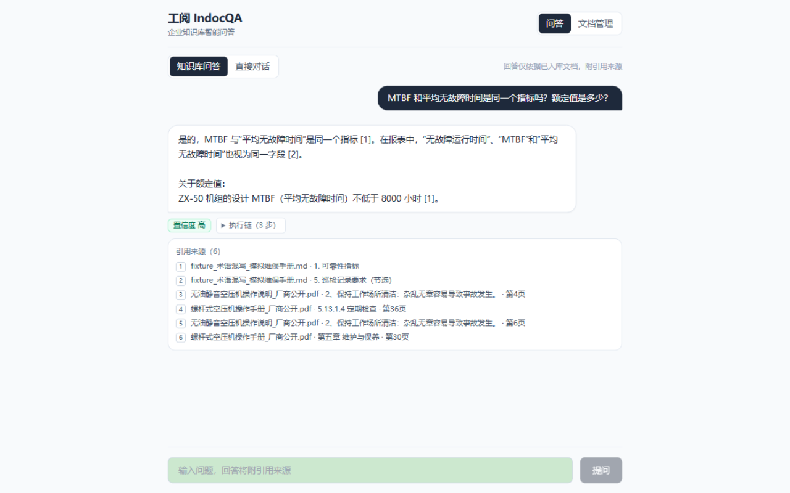
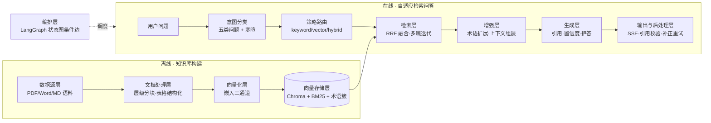

# 工阅 IndocQA · 自适应检索问答

面向工业技术文档的自适应检索问答系统：根据问题类型自动选择检索策略与参数，回答带引用来源、推理链与置信度，并以固定参数基线对比实验量化每一项自适应设计的收益。

`Python 3.11+` · `FastAPI` · `LangGraph` · `Chroma` · `MIT`

## 项目简介

工业文档（设备手册、维修规程、故障代码表、技术规格书）篇幅长、术语密、表格多——固定一套检索参数难以同时覆盖"查术语""查参数""查步骤""查故障""跨文档关联"五类问法。本系统的核心设计是**检索策略自适应**：

- 问题进来先做意图分类，路由到不同的检索策略与参数组合
- 术语缩写与同义异写（MTBF / M.T.B.F. / 平均无故障时间）自动归一扩展
- 需要跨章节、跨文档的问题走迭代式多跳检索，输出逐跳推理链
- **所有策略效果以评测数字说话**：同一评测集在固定参数基线与自适应模式下同口径对比，结论可复现

### 问答与执行链实测

| 带引用来源的回答 | 可展开的检索执行链 |
|---|---|
|  |  |

执行链完整呈现一次回答的检索决策：`multihop → adaptive · multihop → hybrid` 的路由选择、命中条数与术语扩展明细、多跳决策依据。

## 系统架构

离线知识库构建与在线检索增强问答两条链路，共九层：



### 九层职责与实现

| 层 | 职责 | 实现位置 |
|---|---|---|
| 数据源层 | 语料接入与预检（扫描件拒收、重复检测），来源清单记录 | `app/indexing/preview.py`、`data/corpus/sources.md` |
| 文档处理层 | 目录树/标题双路解析、parent-child 分块、表格序列化与题注定位 | `app/parsing/` |
| 向量化层 | local / ollama / minilm 三通道，批量控制，权重随项目 `models/` 分发 | `app/indexing/embedder.py` |
| 向量存储层 | Chroma 持久化、BM25 侧车（含章节标题与同义打标）、后端一致性校验 | `app/indexing/` |
| 检索层 | **本系统重点**：五类意图分类、策略路由表、RRF 混合检索、多跳 Retrieve-Read-Retrieve、跨文档多样化 | `app/retrieval/` |
| 增强层 | 术语同义簇查询扩展（降权补位，不挤占原始命中）、父块上下文 | `app/retrieval/terms.py` |
| 生成层 | 仅据资料作答、逐句引用 [n]、库外拒答、缺引用补正 | `app/generation/` |
| 输出与后处理层 | SSE 事件（trace/sources/token/done）、三信号置信度、引用覆盖降档 | `app/graph/pipeline.py` |
| 编排层 | **本系统重点**：LangGraph 状态图（分类→改写→检索→多跳决策，条件边收敛）、LLM 主备网关 | `app/graph/graph.py` |

### 自适应路由表

| 意图 | 检索策略 | top-k | 术语扩展 | 多跳 |
|---|---|---|---|---|
| 术语解释 | hybrid | 6 | 是 | — |
| 参数查询 | hybrid + 表格加权 | 6 | 是 | — |
| 操作步骤 | hybrid | 6 | — | — |
| 故障诊断 | keyword（精确码匹配） | 8 | 是 | — |
| 多文档关联 | hybrid | 6 | 是 | 最多 2 跳 |
| 寒暄 | 不检索，直接回应 | — | — | — |

`INDOCQA_RETRIEVAL_MODE=adaptive` 启用上表；`fixed` 使用统一参数（评测对照组），两条路径共享同一代码，差异只在策略参数——这是基线对比实验可信的前提。

## 快速部署与实验复现

检索服务内核已随仓库自带（`server/` 源码 + 语料 + 术语簇），自包含可复现。

```bash
# 1. 安装依赖（Python ≥ 3.11）
cd server && pip install -e .

# 2. 建库（幂等）并构建术语簇；嵌入模式经 server/.env 选择（local/ollama/minilm/auto）
python -m app.indexing.ingest ../data/corpus
python -m app.retrieval.terms

# 3. 复现基线对比实验（三配置 × 40 题，自动生成评测报告）
cd .. && python eval/harness.py

# 4. 启动问答服务（与评测共用同一知识库）
cd server && uvicorn app.main:app --port 8000
```

单测：`cd server && python -m pytest -q`（37 个用例，覆盖解析分块、索引幂等、意图路由、多跳与 SSE 接口）。

本地模型权重存放在项目根 `models/` 目录（首次运行经 hf-mirror 自动下载，之后离线可用；随项目整体分发，不依赖项目外缓存）。大模型须调小推理批量：如 `INDOCQA_EMBED_LOCAL_MODEL=intfloat/multilingual-e5-large` 配 `INDOCQA_EMBED_LOCAL_BATCH=8`。

## 评测结果

40 题评测集（术语/参数/步骤/故障/多跳五类，含 7 道跨文档多跳），同一评测集三种配置同口径对比：


| 配置 | Source Recall@5 | Answer 覆盖率 | 多跳跨文档命中 | 延迟 p50 |
|---|---|---|---|---|
| 固定参数基线 | 100% | 81% | 55% | 699 ms |
| **自适应路由（本系统）** | **100%** | 79% | **73%（+18pt）** | 703 ms |
| 消融：去查询侧术语扩展 | 100% | 82% | 64% | 701 ms |

结论（详见 [`docs/基线对比评测报告.md`](docs/基线对比评测报告.md)，含逐题明细）：

- **多跳跨文档命中 73% vs 55%**：意图路由 + 多实体补查是跨文档场景的核心收益来源
- 整体召回三配置持平（100%）：自适应未以召回换路由
- 覆盖率 -2pt 是多跳席位挤占的已知代价，报告如实记录；术语扩展采用"降权补位"策略后不再挤占原始命中
- 嵌入后端选型对比（bge-m3 / e5-large / bge-small-zh，含 Qwen3-Embedding 判负记录）见报告附录

## 项目结构

```
server/   检索问答服务内核（解析/索引/检索/生成/编排）+ 37 个单测
eval/     评测集 dataset.jsonl（40 题）与三配置对比 harness
assets/   术语表种子
docs/     系统文档、基线对比评测报告、界面截图
models/   本地嵌入模型权重（首次运行自动下载，随项目分发）
data/     语料与向量库持久化目录
tools/    sync_kernel.py 内核同步脚本（--src 参数化）
```

## 许可证

[MIT](./LICENSE)
