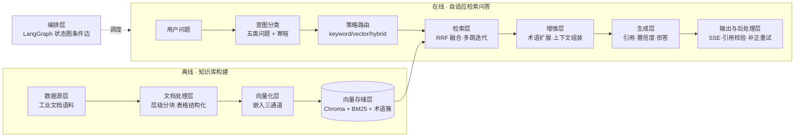
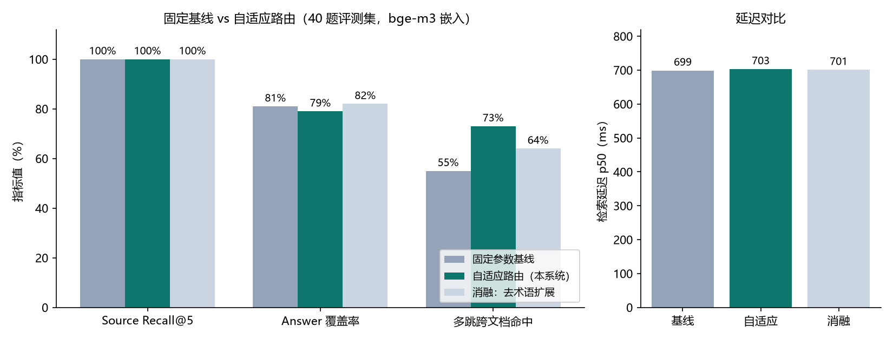

# 工阅 IndocQA · 自适应检索问答

面向工业技术文档的自适应检索问答系统：根据问题类型自动选择检索策略与参数，回答带引用来源、推理链与置信度，并以固定参数基线对比实验量化每一项自适应设计的收益。

`Python 3.11+` · `FastAPI` · `LangGraph` · `Chroma` · `MIT`

| 故障排查问答（keyword 精确路由） | 多跳问答与执行链 |
|---|---|
|  |  |

"空压机报错 E-05 应该怎么处理？"被意图分类为 `fault`，路由到 **keyword 精确匹配**策略（故障码不容语义模糊），术语扩展自动补齐 E05/E-05 两种写法；回答不足处如实声明"资料未覆盖 S-12 具体步骤"而非编造。

## 业务本质

工业文档问答的本质难点是**同一个系统要伺候五种完全不同的问法**：

| 问法 | 例子 | 需要的检索行为 |
|---|---|---|
| 术语解释 | "MTBF 是什么意思" | 语义匹配 + 缩写归一 |
| 参数查询 | "保养周期是多少小时" | 精确命中表格行 |
| 操作步骤 | "排气温度过高怎么处理" | 章节定位 + 步骤完整性 |
| 故障诊断 | "报错 E-05 是什么含义" | 故障码精确匹配 → 关联处置 |
| 多文档关联 | "MTBF 和储气罐的作用分别是什么" | 跨文档多跳，逐跳溯源 |

固定一套检索参数（固定 top-k、纯向量、无扩展）必然顾此失彼。本系统的答案是**意图分类 → 策略路由 → 参数自适应 → 多跳迭代**，并且用同一评测集上的固定参数基线证明每一步的收益。

## 系统架构

离线知识库构建与在线自适应检索问答两条链路，共九层：



### 九层职责与实现

| 层 | 职责 | 实现位置 |
|---|---|---|
| 数据源层 | 语料接入与预检（扫描件拒收、重复检测），来源清单逐份记录 | `app/indexing/preview.py`、`data/corpus/sources.md` |
| 文档处理层 | 目录树/标题双路解析、parent-child 层级分块、表格序列化与题注定位、目录页过滤 | `app/parsing/` |
| 向量化层 | local / ollama / minilm 三通道，批量控制，权重随项目 `models/` 分发 | `app/indexing/embedder.py` |
| 向量存储层 | Chroma 持久化、BM25 侧车（含章节标题与同义打标）、后端一致性校验（40902） | `app/indexing/` |
| 检索层 | **本系统重点**：五类意图分类、策略路由表、RRF 混合检索、多跳 Retrieve-Read-Retrieve、跨文档多样化 | `app/retrieval/` |
| 增强层 | 术语同义簇查询扩展（降权补位，不挤占原始命中）、父块上下文 | `app/retrieval/terms.py` |
| 生成层 | 仅据资料作答、逐句引用 [n]、库外拒答、缺引用补正重生成 | `app/generation/` |
| 输出与后处理层 | SSE 事件（trace/sources/token/done）、三信号置信度、引用覆盖降档 | `app/graph/pipeline.py` |
| 编排层 | **本系统重点**：LangGraph 状态图（分类→改写→检索→多跳决策，条件边收敛）、LLM 主备网关 | `app/graph/graph.py` |

### 关键数据流：一次多跳问答的时序

以"MTBF 和平均无故障时间是同一个指标吗？额定值是多少？"为例（实测执行链见上图）：

1. **意图分类** → `multihop`（连接词 + 双实体），路由 `multihop → hybrid`，扩展开启、允许 ≤2 跳
2. **查询改写**：术语簇命中 MTBF/平均无故障时间/无故障运行时间，词法路扩展、语义路保持原问句
3. **第一跳检索**：混合检索命中 6 条，术语定义与额定值全部覆盖
4. **多跳决策**：实体已全覆盖 → 收敛（未覆盖时生成子查询补查，跨文档题命中单一来源时触发单来源补查）
5. **生成与后处理**：逐句引用、三信号置信度（本例：检索相似度 0.72 + 引用覆盖 + 自评充分 → 高）

### 自适应路由表

| 意图 | 检索策略 | top-k | 术语扩展 | 多跳 |
|---|---|---|---|---|
| 术语解释 | hybrid | 6 | 是 | — |
| 参数查询 | hybrid + 表格加权 | 6 | 是 | — |
| 操作步骤 | hybrid | 6 | — | — |
| 故障诊断 | keyword（精确码匹配） | 8 | 是 | — |
| 多文档关联 | hybrid | 6 | 是 | 最多 2 跳 |
| 寒暄 | 不检索，直接回应 | — | — | — |

`INDOCQA_RETRIEVAL_MODE=adaptive` 启用上表；`fixed` 使用统一参数（评测对照组）。两条路径共享同一代码，差异只在策略参数——这是基线对比实验可信的前提。

## 数据模型与存储选型

| 数据 | 存储 | 选型理由 |
|---|---|---|
| 子块向量 | Chroma（HNSW，余弦空间，持久化） | 嵌入式零运维；集合名携带后端标识，切模型互不污染 |
| 子块全文 | BM25 侧车（jieba 分词，含章节标题与同义打标） | 故障码/型号/缩写的精确匹配靠词法；打标让归一在索引侧也生效 |
| 父块全文 | `parents.json` 侧车 | 子块命中 → 小节全文，生成侧上下文完整 |
| 文档元信息 | `manifest.json`（内容哈希、后端标识） | 幂等去重事实源；切换嵌入后端强制校验，杜绝静默空库 |
| 术语同义簇 | `terms.json`（种子 ∪ 语料抽取，频次过滤） | "MTBF / M.T.B.F. / 平均无故障时间 / 无故障运行时间"这类混写是工业文档的常态 |

## 关键架构决策

1. **RRF 融合而非加权分数**：BM25 分数与余弦相似度尺度不可通约；RRF 只用排名，零调参
2. **术语扩展只进词法路、降权补位**：扩展词进向量路会稀释语义（实测召回 -3pt）；BM25 扩展命中名次后移，只补基线空位
3. **嵌入三通道 + 显式开关**：`local`（进程内 fastembed，权重在项目 `models/`，随项目分发）/ `ollama`（质量最优）/ `minilm` 兜底 / `auto` 自动探测
4. **fixed/adaptive 是运行时开关而非两套代码**：对照组与实验组共享全部代码路径，差异只在策略参数，基线对比才可信

## 嵌入模型调用模式

四个模式是"模型从哪来、谁来推理"的四种方案（`server/.env` 中 `INDOCQA_EMBED_BACKEND` 显式选择）：`local`（进程内直调项目 `models/` 权重，克隆即含默认模型、完全离线，~6ms）、`ollama`（本机 Ollama 服务，质量最优：bge-m3 下 Recall 100%/多跳 73%，~700ms）、`minilm`（内置兜底）、`auto`（探测 Ollama 运行则用之，否则落 local）。

`models/` 目录始终只有平铺的真实权重文件（无软链接）：默认模型随 git 分发克隆即用；用到未分发模型时经镜像下载，完成后自动把真实文件归位到 `models/<模型短名>/` 并删除全部 hf 缓存结构。

运行方案矩阵实测（8 类问题，414 子块知识库）：local+生成 首token p50 1.0s / 要点命中 7/7；local+摘录 51ms（无拒答边界，6/7）；ollama+生成 3.4s / 7/7；fixed 基线组多跳题未命中而 adaptive 命中，与 40 题评测的多跳结论一致。完整矩阵见 `docs/evidence/runtime-matrix-*.md`。`local` 是可插拔槽位——`INDOCQA_EMBED_LOCAL_MODEL` 可指到 e5-large（实测 95%，配 `INDOCQA_EMBED_LOCAL_BATCH=8`）等模型，完整对比见评测报告附录。

## 快速部署与实验复现

检索服务内核已随仓库自带（`server/` 源码 + 语料 + 术语簇 + Web 前端），自包含可复现。

```bash
# 1. 安装依赖（Python ≥ 3.11；前端另需 Node ≥ 18）
cd server && pip install -e .

# 2. 建库（幂等）并构建术语簇；嵌入模式经 server/.env 选择（local/ollama/minilm/auto）
python -m app.indexing.ingest ../data/corpus
python -m app.retrieval.terms

# 3. 复现基线对比实验（三配置 × 40 题，自动生成评测报告）
cd .. && python eval/harness.py

# 4. 启动问答服务与前端
cd server && uvicorn app.main:app --port 8000 &
cd web && npm install && npm run dev   # http://localhost:5173
```

单测：`cd server && python -m pytest -q`（37 个用例：解析分块、索引幂等、意图路由、多跳、SSE 接口）。

本地模型权重存放在项目根 `models/` 目录（首次运行经 hf-mirror 自动下载，之后离线可用）。大模型须调小推理批量：如 `INDOCQA_EMBED_LOCAL_MODEL=intfloat/multilingual-e5-large` 配 `INDOCQA_EMBED_LOCAL_BATCH=8`。

## 内置语料

| 文档 | 类型 | 来源 |
|---|---|---|
| Improving Compressed Air System Performance（美国能源部，128 页） | 英文长文档 | [energy.gov 官方 PDF](https://www1.eere.energy.gov/manufacturing/tech_assistance/pdfs/compressed_air_sourcebook.pdf)，公有领域 |
| TS32S 系列螺杆压缩机操作手册（中英双语，48 页） | 设备手册 | 厂商公开资料 |
| 无油静音空气压缩机使用说明书（10 页） | 设备手册 | 厂商公开资料 |
| 术语混写测试夹具（自造，页首声明） | 评测夹具 | 团队自造（MTBF/E-05/LUB 混排 + 保养周期表） |

出处逐份记录在 [`data/corpus/sources.md`](data/corpus/sources.md)。

## 评测结果

40 题评测集（术语/参数/步骤/故障/多跳五类，含 7 道跨文档多跳），同一评测集三种配置同口径对比：



| 配置 | Source Recall@5 | Answer 覆盖率 | 多跳跨文档命中 | 延迟 p50 |
|---|---|---|---|---|
| 固定参数基线 | 100% | 81% | 55% | 699 ms |
| **自适应路由（本系统）** | **100%** | 79% | **73%（+18pt）** | 703 ms |
| 消融：去查询侧术语扩展 | 100% | 82% | 64% | 701 ms |

结论（完整数字、逐题明细与嵌入后端选型对比见 [`docs/基线对比评测报告.md`](docs/基线对比评测报告.md)）：

- **多跳跨文档命中 73% vs 55%**：意图路由 + 多实体/单来源补查是跨文档场景的核心收益
- 整体召回三配置持平（100%）：自适应未以召回换路由
- 覆盖率 -2pt 是多跳席位挤占的已知代价，报告如实记录
- harness 支持嵌入后端透传（`EVAL_EMBED_BACKEND` 等），不同嵌入模型下的完整对比见报告附录

## 项目结构

```
server/   检索问答服务内核（解析/索引/检索/生成/编排）+ 37 个单测
web/      React + TypeScript + Vite 前端（问答/文档管理/执行链；代理目标可经 VITE_API_TARGET 覆盖）
eval/     评测集 dataset.jsonl（40 题）与三配置对比 harness
assets/   术语表种子
docs/     系统文档、基线对比评测报告、界面截图
models/   本地嵌入模型权重（便携布局随 git 分发；hf 下载缓存不入库）
data/     语料与向量库持久化目录
tools/    sync_kernel.py 内核同步脚本（--src 参数化）
```

## 许可证

[MIT](./LICENSE)
