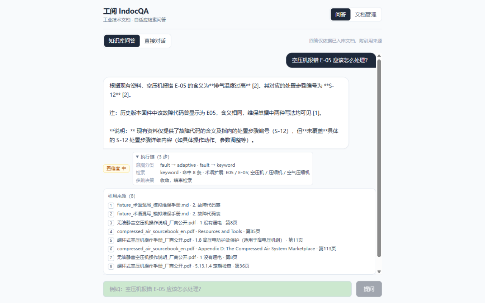
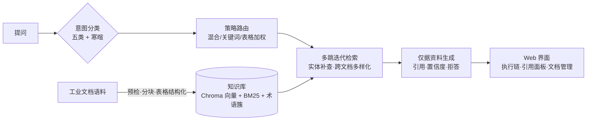

# 工阅 IndocQA · 自适应检索问答

面向**工业技术文档**的检索问答系统：设备手册、维修规程、故障代码表传进来，用自然语言提问，得到**带出处、带推理链、带置信度**的回答。它的特点是**检索策略随问题类型自动切换**——并且每一项设计都有对比实验数字背书。

`Python 3.11+` · `FastAPI` · `LangGraph` · `Chroma` · `MIT License`

| 故障排查问答 | 多跳问答与执行链 |
|---|---|
|  |  |

## 它长什么样：三个真实问答

**① 故障排查（关键词精确路由）**

> **问**：空压机报错 E-05 应该怎么处理？
>
> **答**：E-05 表示**排气温度过高** [1]。处置步骤编号为 S-12：立即停机、检查油位并补充 LUB-46 机油、清理油冷器翅片、检查温控阀、复位重启 [2]。注：现有资料未覆盖 S-12 的完整分步明细。
>
> **来源**：[1] fixture_术语混写 · 2. 故障代码表　[2] 同文档 · 4. S-12 处置步骤
>
> **执行链**：`意图分类 fault → keyword 精确匹配（E-05/E05 双写法归一）→ 命中 8 条`

**② 跨文档多跳（两步检索）**

> **问**：MTBF 和储气罐的作用分别是什么？
>
> **答**：MTBF 即平均无故障时间，本机组设计值不低于 **8000 小时** [1]；储气罐（receiver tank）用于控制峰值需求期的压力降与衰减速率 [2]。
>
> **来源**：[1] 维保手册 · 可靠性指标　[2] 美国能源部空压系统手册 · Compressed Air Storage
>
> **执行链**：`意图分类 multihop → 第一跳命中 → 检测到实体未全覆盖 → 第二跳补查储气罐 → 合并作答`

**③ 资料没有的（拒答不编造）**

> **问**：量子计算机的工作原理是什么？
>
> **答**：现有资料未覆盖该问题。已检索范围：空压系统手册与维保规程，均不涉及该主题。置信度：低。

## 功能特性

- **检索策略随问题而变**：术语解释走混合检索、参数查询表格加权、故障码走关键词精确匹配、跨文档问题自动多跳（≤2 跳）——五类问法各得其所，而非一套参数打天下
- **多跳推理链**：跨章节/跨文档问题自动分步检索，每一步（分类→扩展→每跳命中→收敛判断）在执行链面板可见
- **多轮会话**：新建/切换/删除会话，追问能承接上一轮实体；历史存本地 SQLite，刷新不丢
- **视觉工作区**：可拖拽调宽的深色侧栏、内容卡片、品牌色状态体系、浅/深主题切换，模型下拉按 `.env` 的 model_name 显示，默认第一个可用模型，回答标注实际使用的模型；未配置模型时直接对话自动禁用，知识库问答降级为原文摘录
- **知识边界**：库内无依据时说明已检索范围；配置生成模型时可用通用知识补充并标注"非知识库内容"，未配置则直接拒答
- **回答可溯源**：逐句 [n] 引用到文档、章节、页码、表格行；置信度高/中/低由检索分布、引用覆盖、模型自评三路信号合成
- **术语归一**：`MTBF`/`M.T.B.F.`/`平均无故障时间`/`无故障运行时间` 混写归一，`E-05`/`E05` 双写法都能查到
- **每个结论有数字**：内置 40 题评测集与三配置对比 harness，一条命令复现全部实验
- **自包含可复现**：语料、术语簇、嵌入模型权重全部随仓库分发，克隆即复现
- **入库先体检**：扫描件拒收、重复检测、页数/表格/语言统计，确认后才入库

## 为什么这样设计

工业文档问答的难点是**同一个系统要伺候五种完全不同的问法**：

| 问法 | 例子 | 需要的检索行为 |
|---|---|---|
| 术语解释 | "MTBF 是什么意思" | 语义匹配 + 缩写归一 |
| 参数查询 | "保养周期是多少小时" | 精确命中表格行 |
| 操作步骤 | "排气温度过高怎么处理" | 章节定位 + 步骤完整 |
| 故障诊断 | "报错 E-05 是什么含义" | 故障码精确匹配→关联处置 |
| 多文档关联 | "MTBF 和储气罐的作用" | 跨文档多跳，逐跳溯源 |

朴素 RAG 用一套固定参数应付全部问法，必然顾此失彼。本系统的做法是意图分类（规则实现，毫秒级）→ 策略路由 → 多跳迭代，且用**同一评测集上的固定参数基线**证明收益：

| 配置 | Recall@5 | 多跳跨文档命中 |
|---|---|---|
| 固定参数基线 | 100% | 55% |
| **自适应路由（本系统）** | **100%** | **73%（+18pt）** |
| 消融：去术语扩展 | 100% | 64% |

运行时单题复现：fixed 基线的多跳题未命中、adaptive 命中。完整对比、逐题明细、嵌入后端选型（bge-m3/e5-large/bge-small-zh）见 [`docs/基线对比评测报告.md`](docs/基线对比评测报告.md)。

## 快速开始与实验复现

```bash
# 1. 安装
cd server && pip install -e . && cd ..

# 2. 建库 + 术语簇（幂等；内置工业语料与模型权重，克隆即用）
cd server
python -m app.indexing.ingest ../data/corpus
python -m app.retrieval.terms

# 3. 复现基线对比实验（三配置 × 40 题，自动生成报告）
cd .. && python eval/harness.py

# 4. 启动问答服务与前端
cd server && uvicorn app.main:app --port 8000 &
cd web && npm install && npm run dev    # http://localhost:5173
```

单测：`cd server && python -m pytest -q`（48 个用例）。

<details>
<summary>更多运行方式</summary>

- 嵌入调用模式（`.env` 中 `INDOCQA_EMBED_BACKEND`）：`local`（进程内，默认克隆即用）/ `ollama`（本机 Ollama，bge-m3 质量 Recall 100%）/ `minilm` 兜底 / `auto` 自动探测
- 运行矩阵实测（8 类问题）：local+生成 首token 1.0s·要点命中 7/7；ollama+生成 3.4s·7/7；摘录模式 51ms。详见 `docs/evidence/runtime-matrix-*.md`
- 换嵌入模型：`INDOCQA_EMBED_LOCAL_MODEL`（如 e5-large 配 `_BATCH=8`）；下载后自动归位为 `models/<模型名>/` 平铺真实文件，无软链接

</details>

## 评测集

评测集随仓库分发（`eval/dataset.jsonl`，40 题），覆盖五类问法，每题人工标注来源与答案要点：

| 类型 | 题数 | 考察点 |
|---|---|---|
| 术语解释 | 7 | 缩写/别名归一（MTBF ↔ 平均无故障时间） |
| 参数查询 | 7 | 表格行精确命中（保养周期、住宿标准类） |
| 操作步骤 | 7 | 步骤完整性与顺序 |
| 故障诊断 | 8 | 故障码 → 含义 → 处置的关联链 |
| 多文档关联 | 11 | 跨章节/跨文档两步检索 |

每题的结构（真实样例，可直接查看 `eval/dataset.jsonl`）：

```json
{"id": "term-01", "type": "term",
 "question": "MTBF 是什么意思？和平均无故障时间是一回事吗？",
 "expected_sources": ["fixture_术语混写"],
 "answer_points": ["平均无故障", "8000"]}
```

- `expected_sources`：标准答案应命中的文档（判 Source Recall@5）
- `answer_points`：回答应覆盖的要点词（判覆盖率，支持部分命中）
- 判分支持部分命中与跨文档分档，多跳题另有跨文档命中专项指标

扩充方式：向 JSONL 追加同结构条目即可，`eval/harness.py` 按行读取自动纳入统计；报告含逐题明细，便于定位失分题。

## 内置语料

| 文档 | 类型 | 来源 |
|---|---|---|
| Improving Compressed Air System Performance（128 页） | 英文长文档 | [美国能源部](https://www1.eere.energy.gov/manufacturing/tech_assistance/pdfs/compressed_air_sourcebook.pdf)，公有领域 |
| TS32S 系列螺杆压缩机操作手册（48 页） | 设备手册 | 厂商公开资料 |
| 无油静音空气压缩机使用说明书（10 页） | 设备手册 | 厂商公开资料 |
| 术语混写测试夹具 | 评测夹具 | 自造（页首声明：MTBF/E-05/LUB 混排 + 保养周期表） |

出处逐份记录在 [`data/corpus/sources.md`](data/corpus/sources.md)。

## 开发者



| 目录 | 内容 |
|---|---|
| `server/app/` | 检索问答服务内核（解析/索引/检索/生成/编排）+ 37 个单测 |
| `eval/` | 40 题评测集与三配置对比 harness（逐题明细输出） |
| `web/` | React + TS 前端（代理目标经 `VITE_API_TARGET` 可配） |
| `docs/` | 基线对比评测报告、界面截图、运行矩阵证据 |
| `models/` | 嵌入模型权重（平铺真实文件，随仓库分发） |
| `tools/` | `sync_kernel.py` 内核同步（`--src` 参数化） |

## 许可证

[MIT](./LICENSE)
