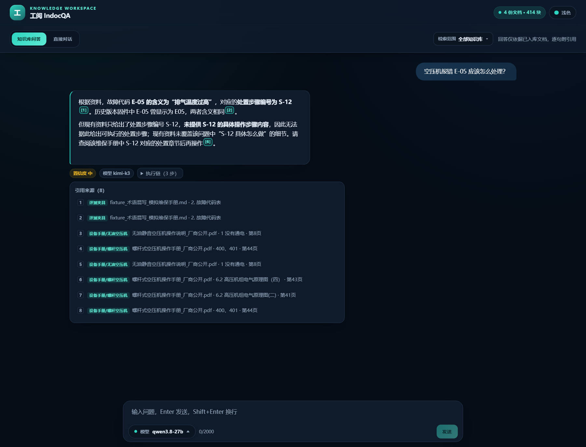

# 功能使用说明

本文档按“问答 → 文档管理 → 会话管理 → 进阶用法”的顺序介绍工阅 IndocQA 的核心功能与操作路径。界面截图见 [`assets/screenshots`](assets/screenshots)。

## 1. 界面总览

启动后打开 `http://127.0.0.1:5174`：

```
┌──────────────┬────────────────────────────────────────────────┐
│ 侧栏          │ 顶栏：品牌 / 知识库规模 / 主题切换              │
│ 新对话        ├────────────────────────────────────────────────┤
│ 问答 / 文档管理│ 问答区：模式切换 · 检索范围 · 消息流 · 输入框   │
│ 最近会话      │ 文档区：统计 · 目录树 · 上传预检 · 文档表格      │
└──────────────┴────────────────────────────────────────────────┘
```

- 左侧栏可拖拽调宽（最大 40vw），双击或按方向键复位
- 右上角可切换浅色/深色主题
- “问答”和“文档管理”通过侧栏顶部切换，状态互不丢失

## 2. 知识库问答

### 2.1 基本提问

1. 进入“问答”页，确认模式为 **知识库问答**
2. 在底部输入问题（Enter 发送，Shift+Enter 换行）
3. 回答会流式逐字展示；首 Token 前会显示“正在检索…”



### 2.2 回答区域怎么读

| 元素 | 含义 |
| --- | --- |
| 正文 `[1]` `[2]` | 引用编号，点击可跳转到下方来源 |
| 置信度徽标 | `高 / 中 / 低`，由检索分布、引用覆盖、模型自评合成 |
| 边界徽标 | “非知识库内容”表示走了通用知识；“资料未覆盖”表示拒答 |
| 模型徽标 | 本次实际使用的模型名 |
| 执行链 | 展开可见分类、检索策略、每跳命中数、收敛判断 |
| 引用来源 | 文档名、章节、页码、表格行与片段预览 |

### 2.3 多轮追问

历史会自动带入上下文。追问可以直接说：

- “它的额定值是多少？”
- “那保养周期呢？”
- “第二步具体怎么做？”

系统会把短追问与上一轮主语合并检索；**明确的新话题**（如“什么是质能方程”）不会被上一轮问题污染。

### 2.4 检索范围

点击右上角“检索范围”：

- 默认全选 = 全库检索
- 可勾选一个或多个目录，回答只使用所选目录内的文档
- 父目录包含子目录；全部取消等价于全库

### 2.5 模型选择

输入框上方的模型下拉展示 `server/.env` 中配置的全部 profile：

- `primary`：主模型
- `profile2`、`profile3`…：备用/扩展模型
- 选择后仅影响后续回答；回答底部会标注实际使用模型

### 2.6 停止、重试与复制

- **停止**：生成中点击“停止”，保留已生成内容并标记“已停止”
- **重试**：失败或超时后点击“重试”，用同一问题重新发起
- **复制**：回答右下角复制图标（悬停出现）→ “复制为 Markdown”或“复制为 TXT”；复制成功有即时提示

### 2.7 直接对话

切换到“直接对话”：

- 不检索知识库，直接用模型通用知识回答
- 未配置模型时该模式自动禁用
- 适合通用概念解释、写作、翻译等场景

### 2.8 典型示例

| 场景 | 输入 | 预期行为 |
| --- | --- | --- |
| 故障排查 | `空压机报错 E-05 应该怎么处理？` | 故障码精确匹配 → 含义 + 处置步骤 + 引用 |
| 参数查询 | `LUB 更换的保养周期是多少小时？` | 表格行命中 → 返回 4000 h 与耗材型号 |
| 术语解释 | `MTBF 和平均无故障时间有什么区别？` | 术语归一 → 同一指标 + 设计值 8000 h |
| 跨文档多跳 | `MTBF 和储气罐的作用分别是什么？` | 两次检索 → 分别引用两份文档 |
| 库外问题 | `量子计算机的工作原理是什么？` | 说明已检索范围；配置模型时标注“非知识库内容” |
| 多轮追问 | 先问“ZX-50 的 MTBF 是多少？”，再问“它的绝缘等级呢？” | 自动承接 ZX-50 主语 |

## 3. 文档管理

### 3.1 上传与预检

1. 进入“文档管理”，点击右上角“上传文档”
2. 选择 PDF / Markdown / TXT（单文件 ≤ 20 MB）
3. 系统先做预检，展示：页数、预计块数、表格数、语言、重复检测、风险提示
4. 预检卡片中可修改“入库目录”，确认后点击“确认入库”
5. 多份文件可点击“全部入库”

预检状态：

- **预检通过**：可直接入库
- **有警示**：例如疑似扫描件、目录占比过高；建议处理后入库
- **不建议入库**：扫描件/空文档等，会被拒绝

### 3.2 目录树

- 支持多级目录（最多 6 级），单级名称 ≤ 40 字
- 只有一个子目录时会自动合并为一行（VSCode 风格）
- 目录名过长时，目录树区域可**横向滚动**查看完整名称，不会撑破面板
- 点击“+ 新建”创建目录；`/` 分隔多级路径
- 选中目录后可“重命名”或“删除”

### 3.3 移动文档

三种方式：

1. **拖拽**：直接把文档行拖到左侧目录；悬停 0.6 秒会自动展开折叠目录
2. **单篇移动**：文档行“移动”按钮 → 选择目标目录
3. **批量移动**：勾选多篇 → “移动到…” → 选择目录

移动后 8 秒内可点击底部提示条“撤销”；服务端撤销窗口为 10 分钟。

### 3.4 AI 辅助分类

- 单篇：文档行“AI”按钮 → 查看候选目录、置信度与理由 → 采纳/调整/驳回
- 批量：右上角“AI 批量分类” → 生成方案 → 逐项预览 → 确认执行
- 仅更新目录元数据，**不重建向量索引**；低置信度文档保持原位
- 分类反馈会写入 `classification_feedback.jsonl`，用于后续规则优化

### 3.5 删除

- 删除文档：文档行“删除”，同时删除向量块、父块与 BM25 记录
- 删除目录：空目录直接确认；含内容时可选
  - **结构上移**：保留子目录，内容移动到上级目录
  - **级联删除**：目录、子目录、文档与索引全部删除，不可恢复

## 4. 会话管理

- **新对话**：侧栏顶部“+ 新对话”
- **切换**：点击“最近会话”中的条目
- **重命名**：会话项悬停菜单
- **删除**：单条删除或“管理”批量删除
- 历史保存在本地 SQLite（`server/data/db/sessions.db`），默认保留 7 天，可在 `.env` 调整

## 5. 进阶用法

### 5.1 结构化 JSON 输出

界面默认返回 Markdown；如需接入业务系统，可调用 API：

```bash
curl -N -X POST http://127.0.0.1:8010/api/chat \
  -H "Content-Type: application/json" \
  -d '{"message":"储气罐的作用是什么？","mode":"kb","responseFormat":"json"}'
```

拼接所有 `token.delta` 后即为合法 JSON，字段见 [API 文档](API.md#42-结构化输出)。

### 5.2 指定模型与检索范围

```json
{
  "message": "E-05 怎么处理？",
  "mode": "kb",
  "profile": "profile2",
  "folders": ["设备手册/螺杆空压机", "评测夹具"]
}
```

### 5.3 直接对话

```json
{ "message": "用三句话解释什么是熵增", "mode": "direct" }
```

### 5.4 图片/公式/表格

- Markdown 表格、代码块、KaTeX 公式（`$...$` / `$$...$$`）均原样渲染
- 代码块内的 `$`、反斜杠不会被误转换
- 回答复制为 Markdown 时保留全部格式；复制为 TXT 时去除标记但保留正文与引用编号

## 6. 常见问题

**Q：为什么回答是“资料未覆盖”？**
A：知识库中确实没有相关内容，或检索范围过滤掉了相关目录。检查 `/api/health` 文档数、检索范围与文档是否已入库。

**Q：为什么回答标注“非知识库内容”？**
A：检索到的资料相似度低于弱命中阈值，系统改用通用知识回答并明确标注。可补充更相关的文档，或缩小检索范围。

**Q：上传成功但搜不到？**
A：确认文档已完成入库（不是仅预检）；检查目录范围；切换嵌入后端后需要重建索引。

**Q：回答很慢或超时？**
A：首 Token 受上游模型影响；45 秒无数据前端会提示重试。可切换更快的模型 profile，或参考 [部署文档](DEPLOYMENT.md#8-常见问题排查)。

**Q：能离线使用吗？**
A：检索可以完全离线（`INDOCQA_EMBED_BACKEND=local`，权重随仓库分发）；生成回答需要本地或远程 OpenAI 兼容模型。

**Q：数据存在哪里？**
A：`server/data/chroma/`（向量与 BM25）、`server/data/db/sessions.db`（会话）、`server/data/uploads/`（原文件）。备份这三个目录即可。
