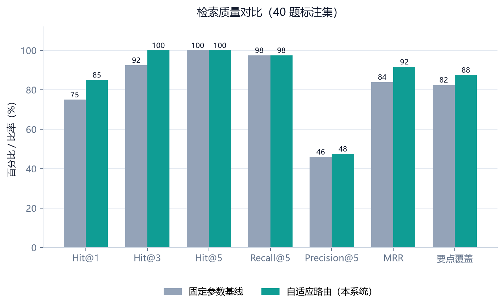
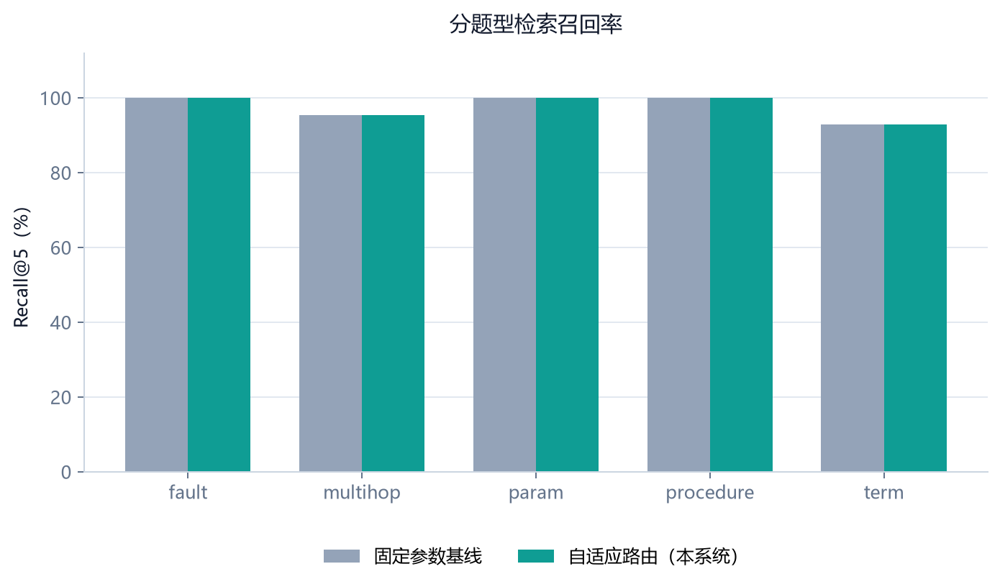
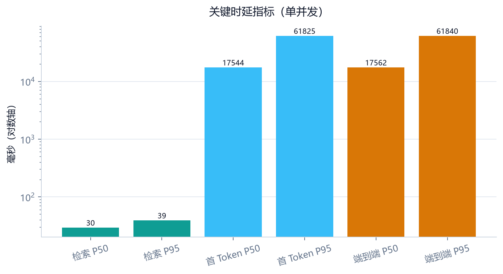
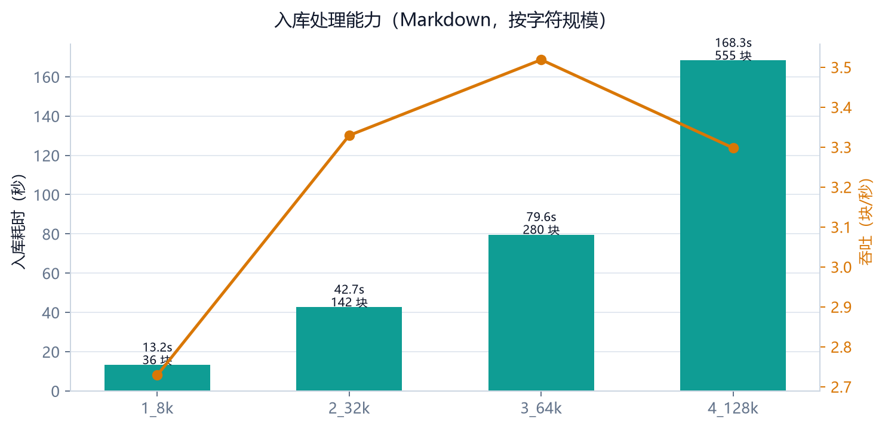
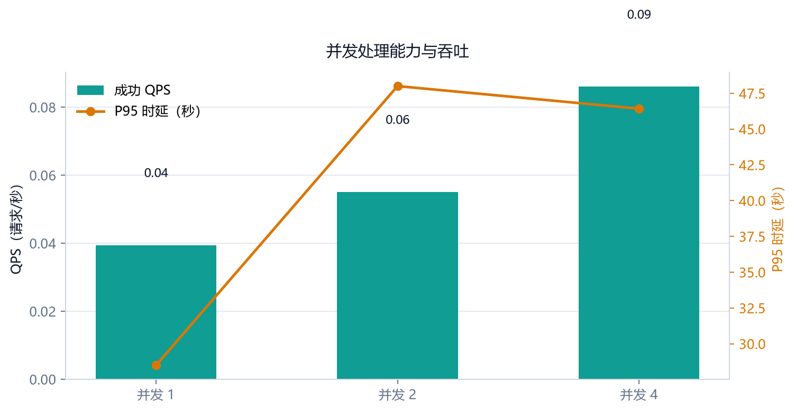

# RAG 系统性能测试报告

- 测试时间：2026-11-11T13:45:00
- 代码版本：`6eb1344`
- 测试环境：Windows-11-10.0.26200-SP0 · Python 3.13.2 · AMD64 Family 25 Model 117 Stepping 2, AuthenticAMD · 16 核 · 内存 31.3 GB
- 嵌入后端：`ollama-bge-m3` / `bge-m3`
- 生成模型（配置主模型）：`qwen3.8-27b`（流式）
- 数据集：`eval/dataset.jsonl` 40 题（术语 7 / 参数 7 / 步骤 7 / 故障 8 / 多跳 11）

> 本报告由 `eval/perf_benchmark.py` 自动生成；原始数据与图表位于 `docs/performance/`。

## 一、核心结论

- 检索质量：自适应路由 Hit@5 **100.0%**、Recall@5 **97.5%**、MRR **0.917**；固定参数基线 Hit@5 100.0%、Recall@5 97.5%。
- 多跳跨文档命中：自适应 **90.9%**，固定基线 90.9%。
- 待改进项：多跳题答案要点覆盖率 68.2%，是后续多跳实体补查与答案组织优化的重点。
- 端到端响应：首 Token P50 **17544 ms** / P95 **61825 ms**；完整回答 P50 **17562 ms** / P95 **61840 ms**。
- 回答可用性：请求成功率 **100.0%**，引用覆盖率 70.0%，答案要点覆盖率 75.0%。
- 入库能力：4 份 / 240,555 字符 / 1013 块，总耗时 **303.7 s**，吞吐 **792 字符/秒**、**3.34 块/秒**。
- 并发能力：并发 4 时成功 QPS 最高 **0.09**（并发 1 为 0.04）；并发 4 下 P95 时延 46420 ms，成功率 100.0%。

## 二、检索质量

### 2.1 总体指标

| 指标 | 固定参数基线 | 自适应路由（本系统） |
| --- | ---: | ---: |
| Hit@1 | 75.0% | 85.0% |
| Hit@3 | 92.5% | 100.0% |
| Hit@5 | 100.0% | 100.0% |
| Hit@10 | 100.0% | 100.0% |
| Recall@5 | 97.5% | 97.5% |
| Precision@5 | 46.0% | 47.5% |
| MRR | 0.840 | 0.917 |
| 答案要点覆盖率 | 82.5% | 87.5% |
| 多跳跨文档命中 | 90.9% | 90.9% |

> Precision@5 为**块级**精确率（前 5 个检索块中来自标注文档的比例）；同一文档多块命中会重复计入，因此该值天然低于文档级命中率，仅用于横向对比，不宜单独作为准确率结论。

- 检索延迟（自适应）：P50 30 ms，P95 39 ms，P99 4805 ms；前两者为进程预热后的稳态值，P99 可能包含首次模型加载/连接建立开销。

### 2.2 分题型 Recall@5

| 题型 | 题数 | 固定参数基线 | 自适应路由 |
| --- | ---: | ---: | ---: |
| fault | 8 | 100.0% | 100.0% |
| multihop | 11 | 95.5% | 95.5% |
| param | 7 | 100.0% | 100.0% |
| procedure | 7 | 100.0% | 100.0% |
| term | 7 | 92.9% | 92.9% |





## 三、端到端响应时间

| 指标 | P50 | P95 | 均值 |
| --- | ---: | ---: | ---: |
| 首 Token（ms） | 17544 | 61825 | 26973 |
| 完整回答（ms） | 17562 | 61840 | 26994 |
| 生成速度（字符/秒） | 7376.8 | 24386.6 | 9443.9 |

- 样本数：10 题（覆盖 5 类问法）；成功率 100.0%。
- 引用覆盖率 70.0%；答案要点覆盖率 75.0%。

### 3.1 逐题明细

| 题号 | 类型 | 首 Token (ms) | 总耗时 (ms) | 来源数 | 引用数 | 要点覆盖 | 状态 |
| --- | --- | ---: | ---: | ---: | ---: | ---: | --- |
| term-01 | term | 17544 | 17562 | 6 | 4 | 100.0% | 成功 |
| term-02 | term | 22064 | 22091 | 0 | 0 | 50.0% | 成功 |
| param-01 | param | 13026 | 13059 | 6 | 1 | 100.0% | 成功 |
| param-02 | param | 23521 | 23542 | 6 | 2 | 100.0% | 成功 |
| proc-01 | procedure | 30853 | 30877 | 6 | 8 | 100.0% | 成功 |
| proc-02 | procedure | 14912 | 14933 | 8 | 2 | 100.0% | 成功 |
| fault-01 | fault | 14190 | 14210 | 8 | 2 | 100.0% | 成功 |
| fault-02 | fault | 11704 | 11725 | 8 | 2 | 100.0% | 成功 |
| multi-01 | multihop | 60087 | 60104 | 6 | 0 | 0.0% | 成功 |
| multi-02 | multihop | 61825 | 61840 | 6 | 0 | 0.0% | 成功 |

- 实际使用模型：kimi-k3 × 10（若与配置主模型不同，说明触发了故障切换）。
- 说明：配置主模型 `qwen3.8-27b` 在本轮未成功返回，以上时延包含故障切换开销；建议检查主供应商配额、限流与网络可用性。



## 四、入库处理能力

- 总量：4 份文档、240,555 字符、1013 个检索块；总耗时 303.7 s。
- 综合吞吐：0.79 份/分钟、792 字符/秒、3.34 块/秒。

| 文档 | 字符数 | 块数 | 预检 (ms) | 入库 (ms) | 索引 (ms) | 字符/秒 | 块/秒 |
| --- | ---: | ---: | ---: | ---: | ---: | ---: | ---: |
| perf_ingest_1_8k.md | 8,387 | 36 | 25 | 13193 | 13169 | 636 | 2.73 |
| perf_ingest_2_32k.md | 33,224 | 142 | 31 | 42654 | 42623 | 779 | 3.33 |
| perf_ingest_3_64k.md | 66,384 | 280 | 51 | 79579 | 79528 | 834 | 3.52 |
| perf_ingest_4_128k.md | 132,560 | 555 | 53 | 168308 | 168255 | 788 | 3.30 |

> `预检` 为解析/分块演练，`入库` 为解析 + 嵌入 + 向量与 BM25 写入的完整链路；`索引` 为两者差值，近似代表嵌入与写入开销。



## 五、吞吐与并发

| 并发度 | 任务数 | 成功 | 成功率 | 墙钟 (s) | QPS | 首 Token P95 (ms) | P95 时延 (ms) |
| ---: | ---: | ---: | ---: | ---: | ---: | ---: | ---: |
| 1 | 4 | 4 | 100.0% | 101.4 | 0.04 | 28480 | 28495 |
| 2 | 4 | 4 | 100.0% | 72.6 | 0.06 | 47983 | 48000 |
| 4 | 4 | 4 | 100.0% | 46.5 | 0.09 | 46399 | 46420 |

资源占用（并发压测期间，后端进程）：CPU 采样低于 0.1%（问答以网络 I/O 等待为主），内存平均 76 MB / 峰值 76 MB。

> 解读：并发 1 → 4 时 QPS 提升约 2.2×，所有请求均成功；服务端内存稳定，说明吞吐瓶颈在外部模型供应商的排队/限流，而不是检索与编排层。



## 六、测试方法

1. **检索质量**：对 40 题标注集逐题调用进程内 `run_retrieval`，比较固定参数与自适应路由；Hit@k 表示前 k 个命中块中出现标注来源文档，Recall@5 按题目的多个期望来源取平均，MRR 取首个相关来源排名的倒数，答案要点覆盖率以检索摘录中命中的标注要点计算。
2. **入库能力**：通过 `POST /api/kb/ingest/jobs` 上传 4 份 8k–128k 字符的 Markdown，轮询任务直到完成；`POST /api/preview` 单独测解析预检。测试文档在结束后删除。
3. **端到端响应**：通过 `/api/chat` SSE 测量首 Token 与完整回答耗时，每题独立会话，结束后删除会话。
4. **并发能力**：以 1/2/4 等并发度分别发起多组问答任务，统计成功率、QPS 与 P95 时延；实际并发度与任务数见上表；同时采样后端进程 CPU 与 RSS。

## 七、复现方式

```bash
# 1. 启动后端（8010）与前端（5173）
cd server && uv run uvicorn app.main:app --port 8010
cd web && npm run dev

# 2. 执行完整性能基准（自动生成数据、图表与本报告）
uv run --project server --with matplotlib --with psutil python eval/perf_benchmark.py
```

## 八、说明与限制

- 测试为**单机单进程**部署，生成模型为外部 API，时延包含网络与上游排队时间；不同时段/不同供应商的结果会有波动。
- 检索质量指标衡量“来源命中”，不等价于最终答案正确率；生成质量另见引用审计与要点覆盖率。
- 并发 QPS 受上游模型限流影响；失败请求会在明细中标注，不剔除、不美化。
- 入库吞吐受文档结构、表格密度、嵌入后端（本机 Ollama bge-m3）影响。

## 九、答辩展示速览

### 9.1 推荐展示顺序

1. **系统架构**：`docs/assets/screenshots/architecture.png`（用户层 → API → 检索 → 上下文 → 生成 → 数据层）。
2. **检索质量**：`charts/chart-retrieval-quality.png` + 分题型召回图，说明自适应路由在 Hit@1、Top3 与 MRR 上的收益。
3. **入库能力**：`charts/chart-ingest.png`，强调“解析预检毫秒级、索引占主要耗时、吞吐随规模线性”。
4. **并发与瓶颈**：`charts/chart-concurrency.png`，说明服务端 100% 成功、内存稳定，QPS 瓶颈在上游模型。
5. **工程保障**：超时/故障切换、引用审计、上下文预算、可复现评测。

### 9.2 一页纸结论

> 在 40 题人工标注集上，自适应检索达到 **Hit@5 100%、Recall@5 97.5%、MRR 0.917**，较固定参数基线的首条命中率提升 **10pt**、MRR 提升 **0.077**；4 份 / 24 万字符文档入库吞吐 **792 字符/秒**；端到端 10 题成功率 **100%**；并发 1→4 时 QPS 提升约 **2.2×** 且无失败，瓶颈明确位于外部模型供应商。

### 9.3 答辩时需主动说明的边界

- 端到端时延包含外部模型排队；本次测试时段主模型未成功，网关全程切换至备用模型，时延包含切换开销。
- 检索指标是“来源命中”，不是“答案完全正确”；多跳题的答案要点覆盖（68.2%）仍有提升空间。
- 并发数据为单机单进程实测，生产环境应结合模型配额、代理超时与重试策略综合评估。
