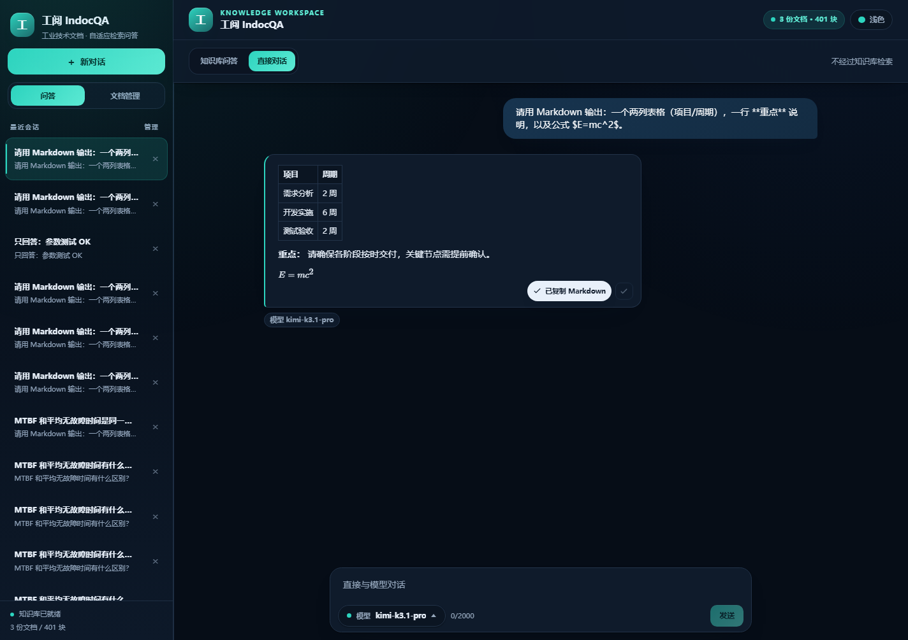
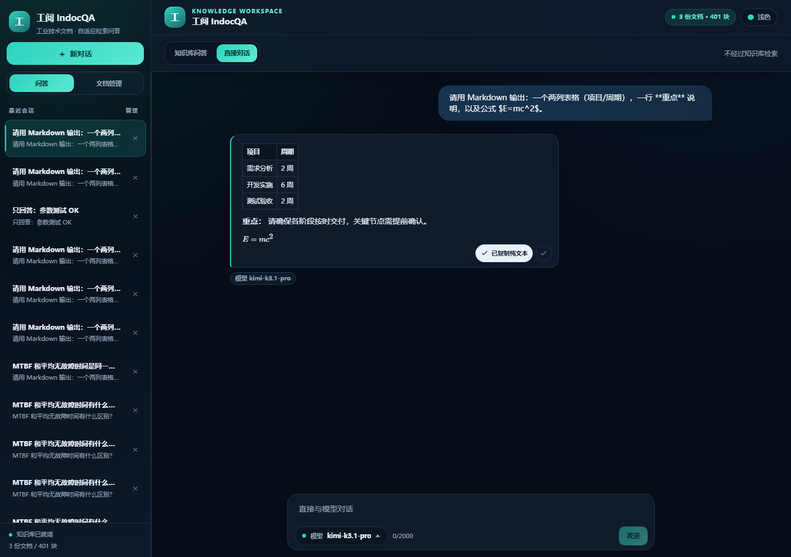

# 生成层模块优化测试报告

> 项目：工阅 IndocQA（单租户工业文档检索问答）
> 测试对象：`server/app/generation/`、`server/app/core/llm.py`、`chat_stream` 生成链路、聊天前端复制交互
> 文档版本：v1.0　测试日期：2026-11-11

---

## 1 测试结论

本轮生成层优化覆盖 Markdown/公式保真、生成参数固化、事实引用、结构化 JSON、安全过滤与回答复制六项能力。后端全量 **136 项 pytest 全部通过**，生成层模块覆盖率 **87%**，Ruff、TypeScript 构建与 ESLint 全部通过；真实模型与真实浏览器交互验证均通过。

| 编号 | 验收项 | 目标 | 实测 | 结论 |
|---|---|---|---|---|
| G1 | Markdown/公式/特殊符号 | 保留合法渲染，无多余转义与无效标记 | 标题、加粗、列表、表格、代码、KaTeX 公式均正常渲染；`2*3`、`LUB_46` 保持原样 | 通过 |
| G2 | 生成参数固化 | 温度、最大长度固定，外部不可覆盖 | 文本 0.0 / 1024，JSON 0.0 / 1536；公开方法无 temperature/max_tokens 参数 | 通过 |
| G3 | 引用来源 | 事实/数据句 100% 可溯源 | 真实回答数据句与事实句覆盖率 100%，表格行自动绑定引用 | 通过 |
| G4 | 结构化 JSON | 标准解析器可直接解析 | `json.loads` 成功，schemaVersion 1.1，字段完整 | 通过 |
| G5 | 安全合规 | 输入/上下文/输出全链路检测 | 违规输入拦截、违规输出拦截、PII/凭据脱敏 | 通过 |
| G6 | 复制交互 | 右下角图标，两种格式，即时反馈 | Markdown/TXT 剪贴板内容正确，反馈“已复制 Markdown/纯文本” | 通过 |

---

## 2 测试环境

| 项 | 配置 |
|---|---|
| 操作系统 | Windows 11 |
| Python | 3.13.2（`server/.venv`） |
| Web 框架 | FastAPI + Uvicorn（8000/8010） |
| 前端 | React 18 + Vite 5 + react-markdown + remark-math + rehype-katex |
| 模型网关 | OpenAI 兼容接口，主供应商 `kimi-k3.1-pro` |
| 嵌入/检索 | Ollama `bge-m3` + Chroma + 混合检索 |
| 测试框架 | pytest 9.2 + pytest-asyncio + pytest-cov |
| 浏览器验收 | Chrome Headless + CDP，真实页面交互与剪贴板读取 |

---

## 3 实现要点

### 3.1 Markdown 保真与净化

新增/重写 `app/generation/formatting.py`：

- **保护代码与公式**：围栏代码、行内代码、`$$...$$`、`$...$` 在清洗前占位，避免被误改；
- **公式归一**：`\(...\)` → `$...$`，`\[...\]` → `$$...$$`，纯数字引用 `\[1\]` 不误判为公式；
- **清理转义残留**：`\*`、`\_`、`\#`、`\[` 等过度转义还原为合法 Markdown；
- **清理无效标记**：空加粗 `****`、空删除线、零宽字符、HTML 注释、空链接；
- **规范化**：统一换行、去除行尾空白、压缩连续空行、合并重复引用 `[1][1]`；
- **保留特殊数据**：`2*3`、`LUB_46`、`℃`、`±`、`→` 等不被 Markdown 规则破坏；
- **外层包裹移除**：模型输出整体包裹的 ```` ```markdown ```` 只保留内部正文。

前端 `Markdown.tsx` 增加 `remark-math` + `rehype-katex`，公式由 KaTeX 渲染；引用链接转换前保护代码与公式，避免破坏矩阵或代码中的 `[n]`。

### 3.2 生成参数固化

`app/core/llm.py` 在网关层按用途读取固定预设，公开方法不接受数值覆盖：

| 用途 | temperature | max_tokens | 说明 |
|---|---|---|---|
| 文本回答 | 0.0 | 1024 | 默认问答 |
| JSON 回答 | 0.0 | 1536 | 保证 JSON 完整 |
| 内部自评 | 0.0 | 32 | 轻量分类，不可外部调用覆盖 |

- `stream(messages, json_mode=False, purpose="default")` 与 `complete(messages, purpose="default")` 均无数值参数；
- `_build_body` 只接受用途与兼容开关，不接受 temperature/max_tokens；
- 请求体始终包含固定 `max_tokens`；模型明确不支持 temperature 时才省略该可选参数，并回传 `temperatureSupported=false`；
- `done` 事件回传实际参数 `generation_params` 与 `policy=fixed`。

### 3.3 引用约束

重写 `app/generation/citations.py` 为 Markdown 感知流程：

- 跳过标题、代码块、公式；
- 列表项保留列表标记，逐句审计；
- 表格表头与分隔行不改写，数据行在最后一个单元格内补 `[n]`；
- 数据句/事实句已有合法引用则保留；无引用时按字符二元组匹配证据自动绑定；
- 无法匹配的数据句/事实句剔除，越界引用清理；
- 输出 `CitationAudit`（数据句、事实句、表格行、覆盖率）进入 `done.citation_audit` 与 JSON `citationAudit`。

### 3.4 结构化输出

`app/generation/structured.py`：

- API 新增 `responseFormat: "text" | "json"`；
- JSON 模式要求模型只输出 JSON；解析失败自动重试一次；
- 无论模型是否返回合法 JSON，服务端最终统一序列化为合法 JSON（模型原文仅作为候选）；
- 输出 schema 1.1：`answer`（Markdown）、`answerPlain`、`citations`、`citationAudit`、`safety`、`generationParams` 等；
- `json_valid` 由服务端 `json.loads` 实际校验。

### 3.5 安全过滤

`app/generation/safety.py` 保留并接入全链路：

- 输入：违规内容直接拦截，返回统一安全拒答，不进入检索；
- 上下文：检索命中逐条检测，违规块丢弃，PII/凭据脱敏；
- 输出：最终 Markdown/JSON 回答再次检测，违规时清空来源并返回拒答；
- 历史消息：发送模型前统一脱敏或替换为拦截占位；
- `done.safety` 回传命中类别，不泄露敏感原文。

### 3.6 复制交互

新增 `web/src/components/CopyButton.tsx` 与 `web/src/lib/text.ts`：

- 助手消息气泡右下角复制图标，悬停/键盘聚焦显示；
- 菜单提供“Markdown 原文”与“纯文本 TXT”；
- Markdown 复制保留标题、列表、表格、公式与引用编号；
- TXT 复制去除 Markdown 标记与公式定界符，保留正文、表格数据与 `[n]`；
- 复制成功即时显示“已复制 Markdown / 已复制纯文本”，1.8 秒后自动恢复。

---

## 4 测试结果

### 4.1 Markdown 与公式

| 用例 | 结果 |
|---|---|
| 标题/加粗/列表/表格/围栏代码保留 | 通过 |
| `\(E=mc^2\)` 归一为 `$E=mc^2$` 并渲染 | 通过 |
| `2*3`、`LUB_46` 不被转义或斜体化 | 通过 |
| 过度转义 `\*` 还原 | 通过 |
| 空加粗/空删除线/零宽字符清理 | 通过 |
| 代码块内 `\(...\)` 不被改写 | 通过 |
| 浏览器实际渲染：`strong=true`、`table=true`、`katex=true` | 通过 |

### 4.2 生成参数

真实文本回答请求参数：

```json
{
  "temperature": 0.0,
  "maxTokens": 1024,
  "temperatureConfigured": 0.0,
  "maxTokensConfigured": 1024,
  "temperatureSupported": true,
  "policy": "fixed"
}
```

JSON 模式实测 `temperature=0.0`、`maxTokens=1536`。签名测试确认 `stream`、`complete`、`_build_body` 均不存在 `temperature` / `max_tokens` 覆盖参数。

### 4.3 引用审计

真实知识库问答（LUB 保养周期）：

- 回答：`LUB 更换（机油）的保养周期为 **4000 小时**，对应耗材为 LUB-46[1]。`
- `dataFacts=1, dataCited=1, dataRemoved=0`，`coverage=1.0`；
- `claims=1, claimsBound=1`，`claimCoverage=1.0`；
- Markdown 表格场景：2 行数据全部在末列补 `[1]`，表头不误改。

### 4.4 JSON 输出

真实 JSON 模式输出经 `json.loads` 解析成功，关键字段：

```json
{
  "schemaVersion": "1.1",
  "answer": "LUB 更换（机油）的保养周期是 **4000 运行小时**，对应耗材为 LUB-46[1]。",
  "answerPlain": "LUB 更换（机油）的保养周期是 4000 运行小时，对应耗材为 LUB-46[1]。",
  "citations": [{"index": 1, "docId": "683220dead04046d", "docName": "fixture_术语混写_模拟维保手册.md"}],
  "confidence": "high",
  "json_valid": true
}
```

### 4.5 安全过滤

| 用例 | 结果 |
|---|---|
| 输入“制作炸弹”类违规请求 | 拦截，返回安全拒答，`boundary=refused` |
| 模型输出违规内容 | 输出阶段拦截，清空来源 |
| 手机号/身份证/银行卡/密钥 | 输出脱敏为 `***` |
| 历史消息与检索上下文 | 逐条检测/脱敏后进入模型 |

### 4.6 复制交互

Chrome Headless 真实页面操作结果：

| 检查项 | 结果 |
|---|---|
| 回答渲染加粗/表格/公式 | `strong=true`、`table=true`、`katex=true` |
| 右下角复制图标 | 存在，点击展开菜单 |
| 复制 Markdown | 剪贴板含 `| 项目 | 周期 |`、`**重点**`、`$E=mc^2$` |
| 复制纯文本 | 剪贴板无 `**`、`##`、表格分隔线，公式为 `E=mc^2` |
| 反馈 | “已复制 Markdown”“已复制纯文本”均即时出现 |

截图：





---

## 5 回归与覆盖率

| 项 | 结果 |
|---|---|
| 后端全量 pytest | **136 项通过**（约 105s） |
| 生成层模块覆盖率 | **87%**（formatting 92%、citations 86%、safety 92%、structured 86%） |
| Ruff check / format | 全部通过 |
| 前端 `npm run lint` | 通过 |
| 前端 `npm run build` | 通过（KaTeX 字体已随构建输出） |
| 真实 UI 验收 | 通过（见截图） |

覆盖率明细：[generation-coverage.json](generation-coverage.json)。

---

## 6 风险与说明

1. **模型兼容性**：主供应商 `kimi-k3` 仅接受 `temperature=0.0`，因此文本默认温度设为 0.0；若切换的模型不支持温度参数，网关仅省略该可选参数，`max_tokens` 始终按配置发送，并在 `generation_params.temperatureSupported` 中标记。
2. **直接对话模式**：不经过知识库检索，因此不产生 `[n]` 引用；知识库问答模式强制引用审计。
3. **Markdown 保留策略**：保留合法 Markdown 是预期行为；“无多余标记”指无过度转义、空标记、无效链接、重复引用、零宽字符等残留，而非删除全部 Markdown。
4. **安全规则**：当前为规则库检测，覆盖常见违规与 PII/凭据；后续可扩展行业敏感词库与模型侧审核。
5. **复制竞态**：按钮仅在回答完成后显示；复制使用 `done.plainText` 或前端 Markdown 转纯文本兜底。

---

## 7 复现命令

```bash
cd server
uv run pytest -q
uv run pytest -q tests/test_generation.py \
  --cov=app.generation --cov-report=term \
  --cov-report=json:../docs/generation-coverage.json
uv run ruff check . && uv run ruff format --check .

cd ../web
npm run lint && npm run build

# UI 复制与公式渲染验收（需后端 8010、前端 5174）
cd ../server && uv run python ../eval/generation_ui_check.py
```
